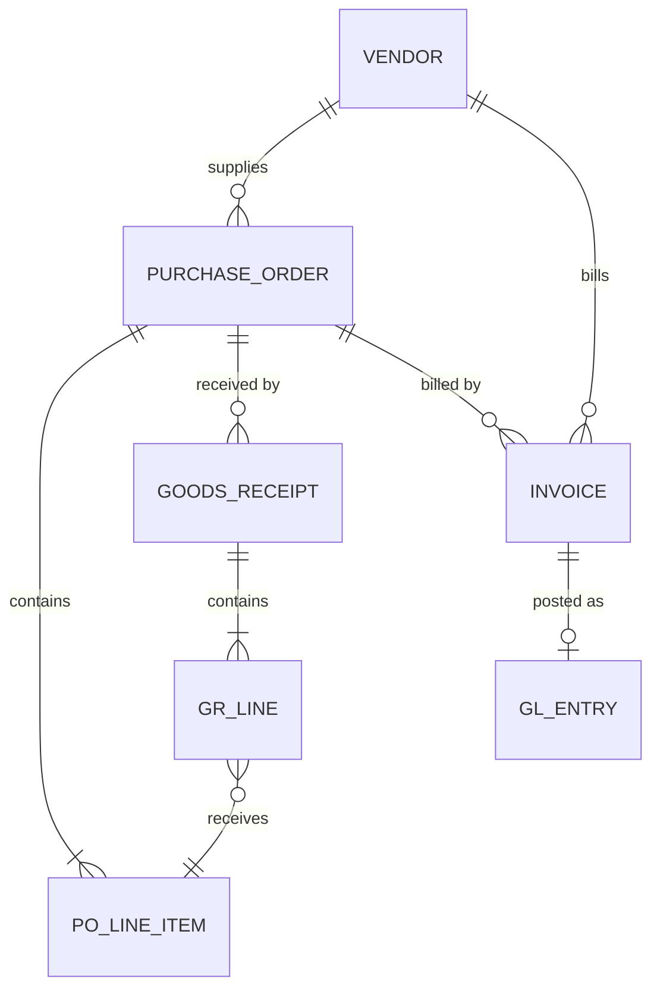
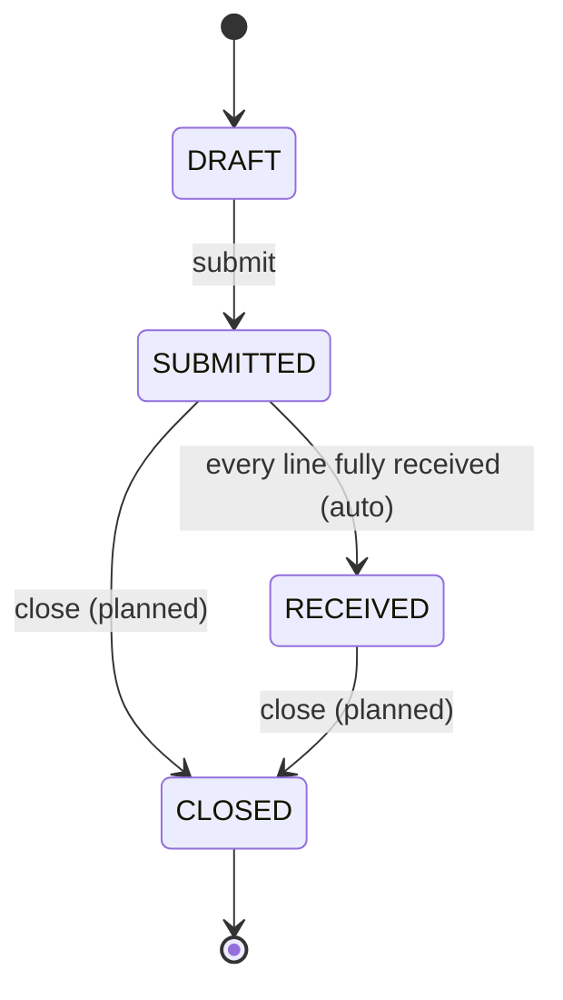
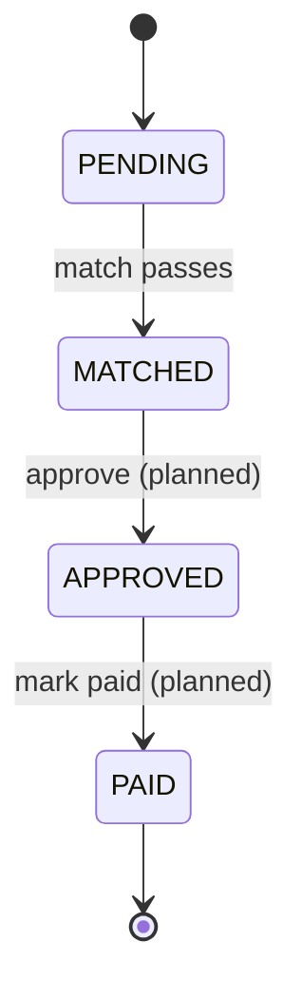

# PO / Invoice 3-Way Match Agent — Specification

**Status:** Draft v3 · **Date:** 2026-11-13

Items marked **✅** are implemented. Items marked **⏳** are planned and not built yet. Open design questions are collected in §9.

---

## 1. Overview

### 1.1 Purpose
A deterministic, rule-based service built with FastAPI. It manages **Purchase Orders (PO)** through drafting, submission and (partial) receipt of goods. It registers vendor **Invoices** against a PO and runs a **3-way match** (PO ↔ goods received ↔ invoice): an invoice passes when its amount is covered by the value of the goods received on its PO.

### 1.2 Stack & conventions
| Concern | Decision |
|---|---|
| Framework | FastAPI, Pydantic v2, SQLAlchemy 2.0 (ORM, typed `Mapped[]`) |
| Database | SQLite (`DATABASE_URL`, default `sqlite:///./eci.db`); the schema stays portable to PostgreSQL |
| IDs | UUIDv4 strings |
| Money | `Decimal`, 2 dp, rounded `ROUND_HALF_UP`. Stored as `NUMERIC(14,2)`, or as exact TEXT on SQLite (which has no exact decimal type) |
| Quantities | `Decimal`, 4 dp. Stored as `NUMERIC(14,4)`, or as TEXT on SQLite |
| Currency / tax | One currency system-wide; no tax. All amounts are net |
| JSON decimals | Serialized **as strings** at full scale (`"25.00"`, `"10.0000"`) |
| Timestamps | UTC, ISO-8601 (`2026-11-13T10:00:00Z`); business dates are `YYYY-MM-DD` |
| Actor | Read from the `X-User` header (defaults to `"system"`) and written to the audit history |
| Transactions | One DB transaction per request, committed **before** the response is sent. Any error rolls it back completely |
| API prefix | `/api/v1` |

### 1.3 Out of scope (v1)
Authentication and authorization, OCR/LLM document extraction, payment execution, tax, multi-currency, goods-receipt corrections or reversals, invoice rejection, credit notes, non-PO invoices, line-level invoicing, chart of accounts.

---

## 2. Entities

### 2.1 Relationship summary

| Entity | Relationship |
|---|---|
| Vendor | 1 — N PurchaseOrder, 1 — N Invoice |
| PurchaseOrder | 1 — N POLineItem, 1 — N GoodsReceipt, 1 — N Invoice |
| GoodsReceipt | 1 — N GoodsReceiptLine; each GR line → 1 POLineItem |
| Invoice | N — 1 PurchaseOrder; 1 — 0..1 GLEntry |
| StatusHistory | Polymorphic (`entity_type`, `entity_id`) → PO / Invoice |



### 2.2 Vendor
| Field | Type | Constraints |
|---|---|---|
| `id` | UUID | PK |
| `code` | str(32) | required, unique, `^[A-Z0-9_-]+$` |
| `payment_terms` | enum | `NET30` \| `NET60`; required |
| `name` | str(255) | required, non-blank |
| `category` | enum | `GOODS` \| `SERVICES`; required |
| `active` | bool | default `true`. Inactive vendors can't get new POs or invoices |
| `created_at` / `updated_at` | datetime | server-set |

### 2.3 PurchaseOrder
| Field | Type | Constraints |
|---|---|---|
| `id` | UUID | PK |
| `po_number` | str(32) | required, **globally unique** |
| `vendor_id` | UUID | FK → Vendor, required; the vendor must be active |
| `order_date` | date | required, ≤ today |
| `status` | enum | `DRAFT` \| `SUBMITTED` \| `RECEIVED` \| `CLOSED`; default `DRAFT` |
| `receipt_status` | enum | **derived**: `NOT_RECEIVED` \| `PARTIALLY_RECEIVED` \| `FULLY_RECEIVED`, from the lines |
| `version` | int | optimistic lock; starts at 1, incremented on every update of the PO row |
| `created_at` / `updated_at` | datetime | server-set |
| `lines` | POLineItem[] | ≥ 1, required on create |

### 2.4 POLineItem
| Field | Type | Constraints |
|---|---|---|
| `id` | UUID | PK |
| `po_id` | UUID | FK → PurchaseOrder |
| `line_number` | int | ≥ 1, unique within the PO |
| `sku` | str(64) | required |
| `description` | str(255) | optional |
| `unit_price` | money | ≥ 0 |
| `line_total` | money | server-computed: round(`quantity_ordered × unit_price`) |
| `quantity_ordered` | qty | > 0 |
| `quantity_received` | qty | **stored**, cumulative, starts at 0. Every goods receipt adds to it while holding the PO lock. It is the source of truth for receipt status and matching. It is **never re-derived** from GoodsReceiptLine rows, which are the audit trail behind it |
| `quantity_remaining` | qty | **derived**: max(`quantity_ordered − quantity_received`, 0) |
| `receipt_status` | enum | **derived**: `NOT_RECEIVED` (0 received), `PARTIALLY_RECEIVED`, `FULLY_RECEIVED` (received ≥ ordered) |

Invariant: `0 ≤ quantity_received ≤ quantity_ordered` (enforced by R6).

### 2.5 GoodsReceipt / GoodsReceiptLine
| Field | Type | Constraints |
|---|---|---|
| `id` | UUID | PK |
| `po_id` | UUID | FK → PurchaseOrder |
| `received_by` | str(64) | required, non-blank |
| `received_date` | date | required, ≥ PO `order_date`, not in the future |
| `lines[].id` | UUID | PK |
| `lines[].po_line_id` | UUID | FK → POLineItem of the **same** PO; at most once per receipt |
| `lines[].quantity_received` | qty | > 0 |

A GR has no status. It takes effect when it is created and cannot be changed or deleted. Because of this, `quantity_received` only ever increases. A receipt may cover any subset of the PO's lines, which is how partial receipts work.

### 2.6 Invoice
| Field | Type | Constraints |
|---|---|---|
| `id` | UUID | PK |
| `invoice_number` | str(64) | required; **unique per vendor**, ignoring case and surrounding whitespace |
| `vendor_id` | UUID | FK → Vendor; required; the vendor must be active and must own the PO |
| `po_id` | UUID | FK → PurchaseOrder |
| `amount` | money | required, > 0 |
| `invoice_date` | date | optional on create, defaults to today (UTC); ≥ PO `order_date` |
| `status` | enum | `PENDING` \| `MATCHED` \| `APPROVED` \| `PAID`; default `PENDING` |
| `due_date` | date | **derived, not stored**: `invoice_date` + 30 or 60 days from the vendor's `payment_terms` |

Invoices are header-only: an amount against a whole PO. The `invoice_lines` table exists in the schema for future line-level invoicing (§9 Q3), but the v1 API never writes to it.

### 2.7 GLEntry ⏳
| Field | Type | Notes |
|---|---|---|
| `id` | UUID | PK |
| `invoice_id` | UUID | FK → Invoice; **unique** (at most one entry per invoice) |
| `debit` | money | equals `invoice.amount` (expense) |
| `credit` | money | equals `invoice.amount` (accounts payable); a DB CHECK enforces `debit = credit` |
| `posted_at` | datetime | server-set |

The table exists. The entry will be created in the same transaction as the invoice's move to `APPROVED` (planned).

### 2.8 StatusHistory (audit)
| Field | Type | Notes |
|---|---|---|
| `id` | UUID | PK |
| `entity_type` | enum | `PURCHASE_ORDER` \| `INVOICE` |
| `entity_id` | UUID | |
| `from_status` | str \| null | null on creation |
| `to_status` | str | |
| `actor` | str | from `X-User` |
| `reason` | str \| null | required on manual close (planned) |
| `at` | datetime | server-set |

Each creation and status change, including automatic ones, writes exactly one row **in the same DB transaction** as the change.

---

## 3. State Machines

Every transition goes through `transition(db, entity, to_status, actor, reason)` in `app/state_machine.py`. A transition that is not listed raises `INVALID_TRANSITION` (409).

### 3.1 PurchaseOrder



| From | To | Trigger | Guards | |
|---|---|---|---|---|
| — | `DRAFT` | `POST /purchase-orders` | §5 validation | ✅ |
| `DRAFT` | `SUBMITTED` | `POST /purchase-orders/{id}/submit` | ≥ 1 line; vendor still active | ✅ |
| `SUBMITTED` | `RECEIVED` | auto, on `POST /purchase-orders/{id}/receive` | every line has `quantity_received ≥ quantity_ordered` | ✅ |
| `SUBMITTED`, `RECEIVED` | `CLOSED` | `POST /purchase-orders/{id}/close` | `reason` required; no `PENDING` or `MATCHED` invoice on the PO; auto-close rule open (§9 Q2) | ⏳ |

A partially received PO stays `SUBMITTED`; its `receipt_status` shows the progress. Goods can only be received while the PO is `SUBMITTED`, so a `RECEIVED` PO has nothing left to receive.

### 3.2 Invoice



| From | To | Trigger | Guards / effects | |
|---|---|---|---|---|
| — | `PENDING` | `POST /invoices` | §5 validation | ✅ |
| `PENDING` | `MATCHED` | `POST /invoices/{id}/match` | `amount ≤ received_value` (§5.3) | ✅ |
| `MATCHED` | `APPROVED` | `POST /invoices/{id}/approve` | **Effect:** create the GLEntry | ⏳ |
| `APPROVED` | `PAID` | `POST /invoices/{id}/mark-paid` | stub for a future payments integration | ⏳ |

- A **failed** match changes nothing. The invoice stays `PENDING` and no history row is written. It can be matched again after more goods arrive.
- Matching an invoice that is already `MATCHED` is allowed and returns 200 with no change. `quantity_received` only increases, so a passed match can't later fail.
- Matching an `APPROVED` or `PAID` invoice returns 409.

---

## 4. Endpoints

All paths are under `/api/v1`. Request and response bodies are JSON, and request bodies reject unknown fields. The optional header `X-User` sets the actor.

### 4.1 Implemented ✅

| Method | Path | Body | Success | Errors |
|---|---|---|---|---|
| GET | `/health` | — | 200 `{"status":"ok"}` (checks the DB) | — |
| POST | `/purchase-orders` | `POCreate` | 201 `PODetail` (`DRAFT`) | 404 vendor · 409 `DUPLICATE` · 422 |
| POST | `/purchase-orders/{id}/submit` | — | 200 `PODetail` (`SUBMITTED`) | 404 · 409 not DRAFT · 422 inactive vendor |
| POST | `/purchase-orders/{id}/receive` | `GRCreate` | 201 `ReceiveResponse` | 404 · 409 not SUBMITTED · 422 over-receipt / bad lines |
| GET | `/purchase-orders/{id}` | — | 200 `PODetail` | 404 |
| POST | `/invoices` | `InvoiceCreate` | 201 `Invoice` (`PENDING`) | **400 `PO_VENDOR_MISMATCH`** · 404 · 409 · 422 |
| POST | `/invoices/{id}/match` | — | 200 `MatchResponse` (`MATCHED`) | 404 · 409 · **422 `AMOUNT_EXCEEDS_RECEIVED`** |
| POST | `/agent/instruct` | `{ "instruction": str }` | 200 `AgentResponse` (§10) | 404 · 409 · 422 `INSTRUCTION_NOT_UNDERSTOOD` |

Interactive docs are served at `/docs` (OpenAPI at `/openapi.json`).

#### `PODetail`
PO header fields (§2.3) plus the derived `receipt_status`; `vendor` (`id`, `code`, `name`, `payment_terms`, `category`, `active`); `lines[]` with every §2.4 field, including `quantity_received`, `quantity_remaining` and `receipt_status`; and `goods_receipts[]` (§2.5), oldest first.

#### `ReceiveResponse`
`{ "goods_receipt": GoodsReceipt, "purchase_order": PODetail }`. The PO is returned as it stands after the receipt.

#### `MatchResponse`
| Field | Notes |
|---|---|
| `invoice_id`, `invoice_status` | status after the match (`MATCHED`) |
| `invoice_amount` | |
| `received_value` | Σ `quantity_received × unit_price` over all PO lines (§5.3) |
| `partial_receipt_pending` | `true` while any line has `quantity_received < quantity_ordered`. **Informational only.** It is independent of the pass/fail decision and never replaces it |
| `lines[]` | per PO line: `po_line_id`, `line_number`, `sku`, `quantity_ordered`, `quantity_received`, `unit_price`, `received_value` |

### 4.2 Planned ⏳
| Area | Endpoints |
|---|---|
| Vendors | `POST /vendors`, `GET /vendors`, `GET /vendors/{id}`, `PATCH /vendors/{id}` |
| Purchase orders | `GET /purchase-orders` (filters: `status`, `vendor_id`, `po_number`), `GET /purchase-orders/by-number/{po_number}`, `PATCH /purchase-orders/{id}` (DRAFT only, with `version`), `DELETE /purchase-orders/{id}` (DRAFT only), `POST /purchase-orders/{id}/close`, `GET /purchase-orders/{id}/history` |
| Goods receipts | `GET /goods-receipts/{id}` |
| Invoices | `GET /invoices`, `GET /invoices/{id}`, `POST /invoices/{id}/approve`, `POST /invoices/{id}/mark-paid`, `GET /invoices/{id}/gl-entry`, `GET /invoices/{id}/history` |
| GL | `GET /gl-entries`, `GET /gl-entries/{id}` |

List endpoints will take `limit` (1–200, default 50) and `offset` and return `{ "items", "total", "limit", "offset" }`.

### 4.3 Error envelope
```json
{
  "error": {
    "code": "AMOUNT_EXCEEDS_RECEIVED",
    "message": "Invoice amount 750.00 exceeds the value received on PO-100 (100.00)",
    "details": [ { "field": "amount", "rule": "MATCH", "message": "must not exceed the value received on the purchase order" } ],
    "data": { "invoice_id": "…", "invoice_status": "PENDING", "invoice_amount": "750.00",
              "received_value": "100.00", "excess": "650.00", "partial_receipt_pending": true }
  }
}
```
`details[]` lists every problem found (field path, rule ID from §5, message). `data` appears only on errors that carry machine-readable values.

| Code | HTTP | When |
|---|---|---|
| `VALIDATION_ERROR` | 422 | Field-level failures (§5.1); FastAPI's default 422 is re-wrapped into this envelope |
| `BUSINESS_RULE_VIOLATION` | 422 | A cross-field or cross-entity rule failed (§5.2) |
| `PO_VENDOR_MISMATCH` | 400 | The invoice's `po_id` belongs to a different vendor (R4). `data`: `po_id`, `po_vendor_id`, `vendor_id` |
| `AMOUNT_EXCEEDS_RECEIVED` | 422 | Match failed (§5.3). `data` as in the example above |
| `NOT_FOUND` | 404 | The entity, or a referenced vendor or PO, does not exist |
| `DUPLICATE` | 409 | `po_number`, or vendor + `invoice_number`, already used |
| `INVALID_TRANSITION` | 409 | The current status does not allow the action |
| `VERSION_CONFLICT` | 409 | Optimistic-lock conflict on a PO |
| `INSTRUCTION_NOT_UNDERSTOOD` | 422 | The agent could not parse an instruction, or a reference in it is ambiguous (§10). `data`: `supported_intents`, `examples` |

### 4.4 Example payloads

**`POST /purchase-orders`**
```json
{
  "po_number": "PO-2026-0100",
  "vendor_id": "<ACME id>",
  "order_date": "2026-11-01",
  "lines": [
    { "line_number": 1, "sku": "BOLT-M8", "description": "M8 hex bolt, box of 100",
      "quantity_ordered": "10", "unit_price": "25.00" },
    { "line_number": 2, "sku": "PANEL-A", "description": "Steel panel 1x2 m",
      "quantity_ordered": "5", "unit_price": "100.00" }
  ]
}
```
Response `201`: `status: "DRAFT"`, `receipt_status: "NOT_RECEIVED"`, `version: 1`, the `vendor` summary, and lines with `line_total` `"250.00"` / `"500.00"`, `quantity_received: "0.0000"` and `quantity_remaining` equal to the ordered quantity.

**`POST /purchase-orders/{id}/receive`** (partial: 4 of 10 on line 1)
```json
{
  "received_by": "warehouse.jdoe",
  "received_date": "2026-11-09",
  "lines": [ { "po_line_id": "<line 1 id>", "quantity_received": "4" } ]
}
```
Response `201`: the new receipt, plus the PO still `SUBMITTED` with `receipt_status: "PARTIALLY_RECEIVED"`. Line 1 shows `received 4.0000 / remaining 6.0000` and `PARTIALLY_RECEIVED`; line 2 is `NOT_RECEIVED`.

**`POST /invoices`**
```json
{ "vendor_id": "<ACME id>", "po_id": "<PO id>", "invoice_number": "INV-88213", "amount": "100.00" }
```
Response `201`: `status: "PENDING"`, `invoice_date` defaulted to today, `due_date` = `invoice_date` + 30 days (NET30).

**`POST /invoices/{id}/match`** (100.00 received so far), response `200`
```json
{
  "invoice_id": "…", "invoice_status": "MATCHED",
  "invoice_amount": "100.00", "received_value": "100.00",
  "partial_receipt_pending": true,
  "lines": [
    { "po_line_id": "…", "line_number": 1, "sku": "BOLT-M8", "quantity_ordered": "10.0000",
      "quantity_received": "4.0000", "unit_price": "25.00", "received_value": "100.00" },
    { "po_line_id": "…", "line_number": 2, "sku": "PANEL-A", "quantity_ordered": "5.0000",
      "quantity_received": "0.0000", "unit_price": "100.00", "received_value": "0.00" }
  ]
}
```

---

## 5. Validation Rules

### 5.1 Field level (Pydantic schemas → 422 `VALIDATION_ERROR`)
| ID | Rule |
|---|---|
| F1 | Required fields are present; strings are trimmed and not blank. A missing or null `vendor_id` on an invoice is rejected here |
| F2 | Quantities > 0, at most 4 decimal places, padded to 4 (`"10"` → `"10.0000"`) |
| F3 | Money ≥ 0 (invoice `amount` > 0), at most 2 decimal places, padded to 2 |
| F4 | `payment_terms` ∈ {`NET30`, `NET60`}; `category` ∈ {`GOODS`, `SERVICES`} |
| F5 | `order_date` and `received_date` are not in the future |
| F6 | `lines` has 1–500 entries on PO create and on receive |
| F7 | Unknown fields are rejected, including server-set and derived ones (`status`, `line_total`, `quantity_received`, `due_date`) |
| F8 | `reason`, where required, is 3–500 chars (planned endpoints) |

### 5.2 Business rules (service layer)
Rule IDs appear in `error.details[].rule`, so they are never renumbered. Gaps are rules that were retired.

| ID | Applies to | Rule | Response |
|---|---|---|---|
| R1 | PO create | `po_number` is unique | 409 `DUPLICATE` |
| R2 | PO create | `line_number` is unique within the PO | 422 |
| R3 | PO create, PO submit, invoice create | The vendor exists and is `active` | 404 / 422 |
| R4 | Invoice create | `po_id` belongs to `vendor_id` | **400 `PO_VENDOR_MISMATCH`** |
| R5 | Invoice create | PO status is `SUBMITTED` or `RECEIVED` | 409 `INVALID_TRANSITION` |
| R6 | Receive | PO status is `SUBMITTED` (else 409); for each line, **`quantity_received + received now ≤ quantity_ordered`**: you can't receive more than was ordered | 409 / 422 |
| R7 | Receive | Every `po_line_id` belongs to the PO and appears at most once | 422 |
| R8 | Invoice create | `(vendor_id, invoice_number)` is unique, ignoring case and whitespace. Enforced by a check and by a unique DB index | 409 `DUPLICATE` |
| R11 | Receive | `received_date` ≥ PO `order_date` | 422 |
| R12 | Invoice create | `invoice_date` ≥ PO `order_date` | 422 |
| R13 | PO PATCH ⏳ | The body's `version` equals the stored version | 409 `VERSION_CONFLICT` |
| R14 | GLEntry ⏳ | `debit == credit == invoice.amount`; one entry per invoice | — |

The rules are checked in this order, and the first failure wins: existence (404), then vendor and status rules, then document rules. Document rules (R2, R6 quantities, R7, R11) are **collected** and reported together in one 422. A rejected request writes nothing.

### 5.3 3-way match rule
```
received_value = round2( Σ over ALL PO lines of (line.quantity_received × line.unit_price) )
```
It uses the **stored** cumulative `quantity_received` on each POLineItem (§2.4), never sums recalculated from the GoodsReceipt records.

| Condition | Result |
|---|---|
| `invoice.amount > received_value` | **422 `AMOUNT_EXCEEDS_RECEIVED`** with the numbers in `error.data`; the invoice status is **unchanged** (`PENDING`) |
| `invoice.amount ≤ received_value` | 200; the invoice becomes `MATCHED` |

`partial_receipt_pending` = any line has `quantity_received < quantity_ordered`. It is reported on success (and in `error.data` on failure). It plays **no part** in deciding pass or fail. An invoice can be `MATCHED` while receipt is still partial.

Preconditions: the invoice is `PENDING` or `MATCHED` (else 409).

---

## 6. Algorithms

```text
def receive(po_id, gr, actor):
    po = lock_po(po_id)                          # §7.2; 404 if missing
    require po.status == SUBMITTED               # else 409 INVALID_TRANSITION
    errors = []
    if gr.received_date < po.order_date:         errors += R11
    for line in gr.lines:
        pl = po.line(line.po_line_id)            # R7: must belong to the PO, once only
        if line.qty > pl.quantity_ordered - pl.quantity_received:  errors += R6
    if errors: raise 422 BUSINESS_RULE_VIOLATION(errors)          # nothing written
    save GoodsReceipt + lines
    for each line: pl.quantity_received += line.qty               # stored cumulative
    if all lines fully received: transition(po, RECEIVED, actor)

def match(invoice_id, actor):
    invoice = get(invoice_id)                    # 404
    require invoice.status in {PENDING, MATCHED} # else 409
    po = lock_po(invoice.po_id)
    received_value = round2(Σ pl.quantity_received * pl.unit_price for pl in po.lines)
    partial = any(pl.quantity_received < pl.quantity_ordered for pl in po.lines)
    if invoice.amount > received_value:
        raise 422 AMOUNT_EXCEEDS_RECEIVED(data={amount, received_value, excess, partial})  # status unchanged
    if invoice.status == PENDING: transition(invoice, MATCHED, actor)
    return {received_value, partial_receipt_pending: partial, lines}
```

---

## 7. Non-functional Requirements

### 7.1 Transactions ✅
`get_db` (`app/database.py`) opens one session per request. FastAPI runs it with `scope="function"`, so the commit happens **before** the response is sent. A client never sees a 2xx for data that was not committed, and any exception rolls back everything, including history rows.

### 7.2 Concurrency ✅
- **PO lock.** Receive, submit and match start with `lock_po`. It issues an `UPDATE purchase_orders SET updated_at=…` as the transaction's first write, then reads the quantities.
  - On PostgreSQL this takes the row lock.
  - On SQLite it opens the write transaction and serializes writers. pysqlite runs SELECTs outside a transaction, so `SELECT … FOR UPDATE` would protect nothing.
  - Verified: 8 parallel 1-unit receipts against 3 remaining units give exactly 3 × 201, and the line stops at 3.
- **Optimistic lock.** `PurchaseOrder.version` is the ORM `version_id_col`; a concurrent update raises `VERSION_CONFLICT`.
- **Race on unique fields.** A race on `po_number` or the invoice number is caught by the DB unique index and returned as 409 `DUPLICATE`.

### 7.3 Idempotency ⏳
Create POSTs will accept an `Idempotency-Key` header:
- Same key and same body → replay the stored response.
- Same key and a different body → 409.

This matters most for `/receive`, which can't be undone.

### 7.4 Project layout ✅
```text
app/
  main.py              # FastAPI app, exception handlers, routers, /health
  database.py          # engine (SQLite pragmas), Base, SessionLocal, get_db, session_scope, init_db
  deps.py              # DbSession (scope="function"), Actor (X-User)
  models.py            # SQLAlchemy models, enums, exact-decimal and UTC column types
  schemas.py           # Pydantic request/response models, error envelope
  errors.py            # DomainError subclasses and envelope handlers
  state_machine.py     # transition tables, transition(), history rows
  po_service.py        # create / submit / receive / detail, lock_po
  invoice_service.py   # create / match
  routers/
    purchase_orders.py
    invoices.py
    agent.py           # POST /agent/instruct
  agent/
    parser.py          # instruction → intent + parameters (pure, rule-based)
    executor.py        # resolve references → API request; one-line summary
    asgi_client.py     # in-process ASGI call into the same app
  seed.py              # python -m app.seed [--reset]
scripts/
  smoke_test.py        # rerunnable end-to-end check against a running server
```

Run it:
```bash
python -m app.seed --reset        # 3 vendors (2 categories), 5 SKUs on 3 sample POs
uvicorn app.main:app --reload     # http://127.0.0.1:8000/docs
```

Seed data:
- **Vendors:** `ACME` (GOODS, NET30), `BOLTCO` (GOODS, NET60), `FIXIT` (SERVICES, NET30).
- **SKUs:** `BOLT-M8`, `PANEL-A`, `GLOVE-L`, `SVC-INSTALL`, `SVC-MAINT`.
- **POs:**
  - `PO-2026-0001`: ACME, SUBMITTED, 10 × BOLT-M8 + 5 × PANEL-A = 750.00.
  - `PO-2026-0002`: BOLTCO, DRAFT.
  - `PO-2026-0003`: FIXIT, SUBMITTED.

---

## 8. Acceptance Scenarios

Shared setup: active vendor `ACME`; PO `PO-1` for ACME with line 1 (10 × 25.00) and line 2 (5 × 100.00), total 750.00.

| # | Given | When | Then |
|---|---|---|---|
| A1 | ACME active | `POST /purchase-orders` with 2 lines | 201 `DRAFT`, `NOT_RECEIVED`, one history row (null → DRAFT) |
| A2 | Vendor inactive | `POST /purchase-orders` | 422 `BUSINESS_RULE_VIOLATION` (R3) |
| A3 | — | `POST /purchase-orders` with `lines: []` | 422 `VALIDATION_ERROR` |
| A4 | Two lines share `line_number` 1 | `POST /purchase-orders` | 422 (R2) |
| A5 | PO-1 DRAFT | `/receive` | 409 `INVALID_TRANSITION` |
| A6 | PO-1 DRAFT | `/submit` | 200 `SUBMITTED`; `/submit` again → 409 |
| A7 | PO-1 SUBMITTED | receive line 1 qty 4 | 201; line 1 `PARTIALLY_RECEIVED` (4 / remaining 6), line 2 `NOT_RECEIVED`; PO stays `SUBMITTED` |
| A8 | A7 | receive line 1 qty 7 | 422 (R6: 4 + 7 > 10); nothing written |
| A9 | A7 | `POST /invoices` with BOLTCO's `vendor_id` for PO-1 | **400 `PO_VENDOR_MISMATCH`** |
| A10 | A7 (received value 100.00) | invoice 100.00 → `/match` | 200 `MATCHED`, `received_value` 100.00, `partial_receipt_pending: true` |
| A11 | A7 | invoice 750.00 → `/match` | **422 `AMOUNT_EXCEEDS_RECEIVED`**, `excess` 650.00; invoice still `PENDING` |
| A12 | A11 | receive line 1 qty 6 + line 2 qty 5, then `/match` the 750.00 invoice | PO auto `RECEIVED`; match 200 `MATCHED`, `partial_receipt_pending: false` |
| A13 | PO-1 `RECEIVED` | `/receive` | 409 `INVALID_TRANSITION` |
| A14 | Invoice `INV-1` for ACME | create ` inv-1 ` for ACME | 409 `DUPLICATE` (R8) |
| A15 | — | `POST /invoices` without `vendor_id` | 422 `VALIDATION_ERROR` (field `vendor_id`) |
| A16 | Line with 3 remaining | 8 concurrent 1-unit receipts | exactly 3 × 201; the rest 409 or 422; `quantity_received` = 3 |

---

## 9. Open Questions

1. **Several invoices on one PO.** The match compares each invoice with the PO's **entire** received value. Other invoices that are already matched against it are ignored. So a 100.00 and a 750.00 invoice both pass against 750.00 received. Proposed fix: compare against `received_value − Σ amount of the PO's other MATCHED/APPROVED/PAID invoices`.
2. **PO close and auto-close.** The old rule ("every line fully invoiced") relied on invoice lines. With header-only invoices, a candidate rule is "Σ approved invoice amounts ≥ PO total". Manual close is still planned.
3. **Invoice lines.** The `invoice_lines` table is unused. Either drop it, or bring back line-level invoicing later.
4. **Approve / GL.** Should approval check the received value again (it can only have grown), and should it be allowed only from `MATCHED`?

---

## 10. Agent Wrapper ✅

`POST /api/v1/agent/instruct` takes `{"instruction": "<plain English>"}` and works in three steps:
1. **Parse.** A rule-based parser turns the instruction into an intent and parameters. It is deterministic and needs no LLM.
2. **Resolve and call.** Names are resolved to ids: vendor code → id, PO number → id, SKU → PO line, invoice number → id. The agent then calls **one** endpoint of this API **in-process**, through the real ASGI app, so routing, validation, transactions and error handling are exactly those of an HTTP client.
3. **Report.** It returns the API's response untouched, plus a one-line plain-English `summary`.

The agent never re-implements business rules. For example, an inactive vendor is passed through, and the API rejects it.

| Intent | Example | Calls |
|---|---|---|
| `create_po` | `Create a PO for 50 units of SKU-9234 from vendor ACME at $12.50/unit` (several items with "and"; optional `number PO-123`, `dated YYYY-MM-DD`) | `POST /purchase-orders` (generated `po_number` if none given; `order_date` today) |
| `submit_po` | `Submit PO-2026-0001` | `POST /purchase-orders/{id}/submit` |
| `receive_goods` | `Receive 4 units of BOLT-M8 on PO-2026-0001` · `Receive 2 of line 1 on …` · `Receive everything on …` | `POST /purchase-orders/{id}/receive` (`received_by` = `X-User` or `"agent"`; date today) |
| `get_po` | `Show PO-2026-0001` · `What's the status of PO X?` · bare `PO-2026-0001` | `GET /purchase-orders/{id}` |
| `create_invoice` | `Record invoice INV-77 from ACME for $100 on PO-2026-0001` | `POST /invoices`. The vendor must be **stated**. It is never copied from the PO, so the vendor/PO check still applies |
| `match_invoice` | `Match invoice INV-77 from ACME` (vendor optional unless the number is ambiguous) | `POST /invoices/{id}/match` |

**`AgentResponse`:** `instruction`, `intent`, `parameters` (as written in the instruction), `api_call` (`method`, `path`, `body`), `api_response` (`status_code`, `body`, exactly as the API returned it) and `summary`.

**Status codes:**
- **200** whenever an API call was made, even if the API rejected it. The API's outcome is in `api_response.status_code`, and the summary explains it, e.g. "Invoice AG-B was not matched: its amount 625.00 exceeds the 250.00 received on PO-… by 375.00, so it stays PENDING."
- **422 `INSTRUCTION_NOT_UNDERSTOOD`**: the instruction could not be parsed, or a reference is ambiguous (a SKU on several lines, an invoice number shared by several vendors). The response includes a hint and examples.
- **404**: a named vendor, PO or invoice doesn't exist.
- **409**: "receive everything" when nothing is left.
